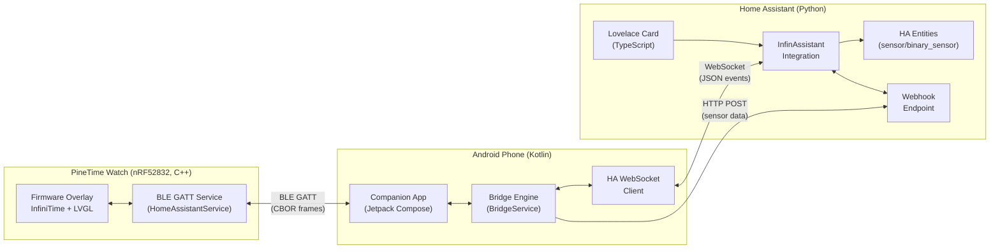

# System Architecture Overview

## Purpose

InfinAssistant Bridge connects a [PineTime](https://pine64.org/devices/pinetime/) smartwatch to [Home Assistant](https://www.home-assistant.io/) via an Android companion app. It enables watch-based control of HA entities (lights, switches, scenes), push notifications, sensor reporting, voice assistant access, and configurable watch face layouts -- all over Bluetooth Low Energy.

---

## Repositories

| Repository | Contents |
|------------|----------|
| [`ryan-werts/infinassistant-firmware`](https://github.com/ryan-werts/infinassistant-firmware) | Watch firmware (InfiniTime fork with the InfinAssistant overlay). This overview and the protocol specification are in `infinassistant/docs/`. |
| [`ryan-werts/infinassistant-bridge`](https://github.com/ryan-werts/infinassistant-bridge) | Android companion app, InfinAssistant Bridge. |
| [`ryan-werts/infinassistant-ha`](https://github.com/ryan-werts/infinassistant-ha) | Home Assistant integration and its Lovelace card. |

---

## Component Diagram



**ASCII fallback** (for environments without Mermaid rendering):

```
┌─────────────────────────────────────────────────────────────────────────┐
│                          System Components                              │
│                                                                         │
│  ┌──────────────┐    BLE GATT    ┌─────────────────┐   WebSocket       │
│  │   PineTime   │◄──────────────►│  Android App    │◄──────────────►   │
│  │   Watch      │  CBOR frames   │  (Kotlin)       │  JSON/events       │
│  │  (C++/LVGL)  │                │  BridgeService  │                    │
│  └──────────────┘                └────────┬────────┘                    │
│                                           │                             │
│                                      HTTP POST                          │
│                                      (sensor data)                      │
│                                           │                             │
│                                           ▼                             │
│  ┌────────────────────────────────────────────────────────┐            │
│  │  Home Assistant                                         │            │
│  │                                                         │            │
│  │  ┌──────────────────┐    ┌─────────────────────────┐   │            │
│  │  │  InfinAssistant  │◄──►│  Lovelace Card          │   │            │
│  │  │  Integration     │    │  (TypeScript)           │   │            │
│  │  │  (Python)        │    └─────────────────────────┘   │            │
│  │  │                  │                                   │            │
│  │  │  Webhook ────────┼──── sensor/binary_sensor          │            │
│  │  │  Entities        │    entities (HA state)            │            │
│  │  └──────────────────┘                                   │            │
│  └────────────────────────────────────────────────────────┘            │
└─────────────────────────────────────────────────────────────────────────┘
```

---

## Four-Tier Architecture

| Tier | Language | Key Frameworks | Source |
|------|----------|----------------|--------|
| HA Integration | Python | HA custom component, voluptuous | `ryan-werts/infinassistant-ha` (`custom_components/infinassistant/`) |
| Lovelace Card | TypeScript | Lit, custom elements | `ryan-werts/infinassistant-ha` (`www/infinassistant-watchface/`) |
| Android App | Kotlin | Jetpack Compose, Coroutines/Flow, NimBLE, OkHttp | `ryan-werts/infinassistant-bridge` |
| Firmware Overlay | C++ | InfiniTime (FreeRTOS, NimBLE, LVGL 7), nRF52832 | `ryan-werts/infinassistant-firmware` |

---

## BLE Protocol Summary

Communication between Android and watch uses a custom CBOR-encoded binary protocol over BLE GATT.

| Aspect | Detail |
|--------|--------|
| Transport | BLE GATT — TX Notify (watch → phone), RX Write (phone → watch) |
| Service UUID | `00060000-78fc-48fe-8e23-433b3a1942d0` |
| Framing | 9-byte header: `[version][type][flags][msgId:2][totalLen:2][chunkIdx][chunkCount]` |
| Encoding | CBOR (TinyCBOR on firmware, kotlinx.serialization.cbor on Android) |
| Max payload | 10,240 bytes (enforced by FrameCodec on both sides) |
| Reconnect | Handled by Android BridgeService; watch is passive peripheral |

### Key Protocol Messages

| Code | Name | Direction | Purpose |
|------|------|-----------|---------|
| `0x01` | HELLO | Bidirectional | Connection handshake; capabilities + diagnostics |
| `0x02` | CONFIG_PUSH | Phone → Watch | Push config version and HA integration settings |
| `0x04` | STATE_UPDATE | Phone → Watch | Push HA entity state changes |
| `0x06` | ACTION_INVOKE | Watch → Phone | User triggered action (tile tap, button) |
| `0x08` | NOTIFY | Phone → Watch | Push notification to watch display |
| `0x0C` | SENSOR_REPORT | Watch → Phone | Periodic sensor data (steps, HR, battery) |
| `0x0E` | WATCHFACE_LAYOUT | Phone → Watch | Configure watch face screens and tiles |
| `0x0F` | TIME_SYNC | Phone → Watch | Synchronize watch clock |
| `0x13` | CALENDAR_UPDATE | Phone → Watch | Calendar events for the day |
| `0x15` | HOME_CONTROL_UPDATE | Phone → Watch | Home control device states |
| `0x17` | HELLO_ACK | Phone → Watch | Protocol negotiation ACK |
| `0x19` | CONFIG_PUSH_ACK | Watch → Phone | Config applied with CRC-32 |

Full schema: [BLE Protocol Specification](ble-protocol-spec.md).

---

## Key Data Flows

### Connection Handshake

```
Phone (Android)                             Watch (PineTime)
     │                                           │
     │ ──────────── HELLO (0x01) ──────────────► │  phone identifies; sends features
     │ ◄─────────── HELLO (0x01) ──────────────  │  watch sends diagnostics + features
     │ ──────────── HELLO_ACK (0x17) ──────────► │  phone confirms compatible version
     │                                           │
     │ ──────────── CONFIG_PUSH (0x02) ────────► │  config version and HA integration config
     │ ◄─────────── CONFIG_PUSH_ACK (0x19) ────  │  echo CRC-32 of applied config
     │                                           │
     │ ──────────── STATE_UPDATE (0x04) ───────► │  initial entity states
     │ ──────────── TIME_SYNC (0x0F) ──────────► │  sync clock
     │ ──────────── WATCHFACE_LAYOUT (0x0E) ───► │  apply watch face layout
     │ ◄─────────── WATCHFACE_ACK (0x12) ──────  │  layout applied OK
```

### Sensor Reporting (Watch → HA)

```
Watch (every N seconds)
  → SENSOR_REPORT (0x0C) via BLE GATT Notify
  → Android BridgeService receives, decodes CBOR
  → HTTP POST to HA webhook URL (signed with HMAC)
  → HA integration updates sensor entities
  → HA state machine propagates to dashboards / automations
```

### Watch Face Push (HA → Watch)

```
User clicks "Push" in Lovelace card
  → infinassistant.push_watchface_layout service call
  → HA integration serialises layout, fires WebSocket event
  → Android BridgeEngine receives, encodes WATCHFACE_LAYOUT CBOR
  → BLE GATT write (chunked via FrameCodec, 9-byte headers)
  → Firmware BridgeController decodes, applies to LVGL screens
  → WATCHFACE_ACK (0x12) sent back to phone
```

### Action Invocation (Watch → HA)

```
User taps tile on watch face
  → HomeAssistant LVGL screen calls HomeAssistantService.InvokeAction()
  → BridgeController encodes ACTION_INVOKE (0x06) CBOR
  → BLE GATT Notify → Android FrameCodec reassembly
  → BridgeEngine decodes, calls HA service via WebSocket
  → HA executes action (e.g., light.toggle)
  → ACTION_RESULT (0x07) returned to watch
```

---

## Firmware Constraints (nRF52832)

| Resource | Limit | Notes |
|----------|-------|-------|
| Flash | 512 KB | Shared with InfiniTime base; MCUboot uses ~24 KB |
| RAM | 64 KB | Static allocations preferred; heap used for CBOR decode only |
| LVGL pool | 9 KB | Isolated static pool (`LV_MEM_CUSTOM=0`) |
| BLE message queue | 16 × 512 B | Oldest dropped on overflow |
| Flow control | 5 pending notifications | Prevents NimBLE mbuf exhaustion |
| CBOR nesting depth | 10 | Enforced before parse; rejects deeper payloads |

Static structs must have all-zero defaults to stay in `.bss` (not `.data`). Any non-zero default forces the struct into `.data`, consuming flash and risking MCUboot swap failure.

---

## Component Pages and Sources

Component pages are internal and are not published. The published sources are the three repositories in the table at the top of this page; each repository's README describes its own build and test steps.

---

## Operational Notes

- **Android**: Requires Android 12+ (minSdk 31), SDK 36. The APK embeds the firmware DFU zip for OTA updates.
- **Firmware**: Builds with an ARM GCC cross-compiler. MCUboot DFU for OTA. Constrained to 512KB flash / 64KB RAM.
- **HA Integration**: Installed through HACS or from the release zip. The Lovelace card ships inside the integration and is built with npm.
- **Artifacts**: Release APKs and firmware DFU zips are attached to the GitHub Releases of the bridge and firmware repositories, with version-stamped filenames.
